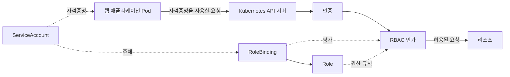

# WHS Kubernetes Security

WhiteHat School 4기 | Kubernetes 보안 팀 프로젝트

## 프로젝트 개요

Kubernetes 환경의 보안 시나리오를 조사·설계하고, 웹 애플리케이션의 입력 처리와 인프라 권한의 관계를 분석한 교육용 팀 프로젝트입니다. 실습 환경과 웹 애플리케이션, 검증과 문서화는 팀원들과 협업했습니다.

## 실습 환경과 아키텍처

컨테이너 기반 웹 애플리케이션이 Kubernetes Pod에서 실행되고, Pod에 연결된 ServiceAccount와 RBAC를 통해 Kubernetes API 접근 범위를 살펴보는 구조입니다. 아래 그림은 구체적인 팀 환경이 아닌 보안 개념을 설명하는 일반화된 논리도입니다.

Pod의 프로세스가 자격증명을 사용해 요청하면 API 서버가 요청을 인증하고 인가 단계에서 관련 권한을 평가합니다. Role은 허용 동작을 정의하고 RoleBinding은 주체와 역할을 연결합니다.

## 보안 시나리오 조사

네 가지 후보를 비교하고 선정 기준을 정리했습니다.

| 후보 | 조사한 보안 관점 | 범위 |
|---|---|---|
| ServiceAccount / RBAC 과도 권한 | 워크로드의 API 권한과 최소 권한 | 시나리오 1 설계·구성 주제 |
| Privileged Container / hostPath | 컨테이너와 호스트 간 격리 경계 | 후보 조사 |
| 웹 애플리케이션 취약점을 통한 내부 접근 | 웹 입력 처리와 내부 환경 접근의 관계 | 후보 조사 및 시나리오 1의 웹 진입점과 관련 |
| EKS Pod Identity / IAM | Kubernetes 워크로드와 클라우드 IAM 권한의 관계 | 후보 조사 |

EKS 관련 항목은 조사 후보이며 시나리오 1의 직접 구현 환경이나 검증 결과를 뜻하지 않습니다.

## 시나리오 1 — ServiceAccount / RBAC

웹 애플리케이션과 Kubernetes 권한 사이의 보안 경계를 설명하기 위해 ServiceAccount와 RBAC를 중심으로 시나리오를 설계했습니다. 애플리케이션의 입력 처리 문제와 Pod에 부여된 권한은 서로 다른 계층이지만, 두 문제가 함께 존재하면 영향 범위가 커질 수 있습니다.

Pod에 연결된 ServiceAccount의 자격증명으로 API를 호출할 수 있는 경우, 실제로 허용되는 동작은 인가 정책에 따라 결정됩니다. 따라서 애플리케이션 취약점을 줄이는 것과 함께 워크로드에 필요한 최소 권한만 부여하는 것이 중요합니다.

## 기술 분석 및 보안 개선 방향

기존 정적 분석에서는 교육용 웹 애플리케이션의 입력 처리와 Kubernetes 권한 관계를 살펴봤습니다. 다음은 그와 구분한 일반적인 방어 방향입니다.

- 사용자 입력은 사용 목적에 맞는 허용 목록으로 검증합니다.
- 사용자 입력을 셸 명령 문자열에 결합하지 않고, 가능하면 전용 라이브러리나 안전한 인자 전달 방식을 사용합니다.
- Kubernetes API 접근이 필요하지 않은 워크로드에서는 ServiceAccount 토큰 자동 마운트를 제한합니다.
- 각 워크로드에 필요한 리소스와 동작만 RBAC로 허용합니다.
- non-root 실행, 권한 상승 방지, 불필요한 capability 제거 등 Pod 보안 설정을 검토합니다.

## 검증 범위

기존 조사에서는 교육용 애플리케이션과 Kubernetes 설정의 존재 및 관계를 정적으로 확인했습니다. 사용자는 팀의 실행·검증 과정에 참여했지만, 이 페이지의 근거로 사용할 실행 로그나 캡처는 확인되지 않았습니다. 공격 성공이나 특정 권한 획득을 검증된 결과로 주장하지 않습니다.

## 개인 기여 및 팀 협업

- 보안 시나리오 후보 4개를 조사하고 선정 기준을 정리했습니다.
- 시나리오 1의 ServiceAccount / RBAC 보안 문제 설계에 참여했습니다.
- 교육용 웹 애플리케이션 개발과 실행·검증 과정에 참여했습니다.
- 보고서와 발표 자료 작성에 참여했습니다.

최종 산출물은 팀 공동 작업이며, 특정 코드나 Kubernetes 설정을 개인 단독 구현으로 주장하지 않습니다.
