# WHS Kubernetes Security

WhiteHat School 4기 | Kubernetes 보안 팀 프로젝트

## 01. 프로젝트 개요

WhiteHat School 4기의 교육용 레드팀 프로젝트로, 교육용으로 구성한 세 개의 독립된 Kubernetes 환경에서 애플리케이션 취약점과 인프라 권한 설정이 결합할 때의 영향을 팀 단위로 평가했습니다. 각 환경은 별도의 진입점과 검증 범위를 가지며 하나의 연속된 공격 경로가 아닙니다.

팀은 시나리오 조사와 선정, 교육용 환경·애플리케이션 구성, 시나리오 구현과 검증, 탐지·대응 검토 및 최종 보고서 작성을 수행했습니다. 주요 기술은 Kubernetes, AWS EC2 / EKS, kubeadm, ServiceAccount / RBAC, Argo CD, Falco, Kubernetes Audit, Kyverno와 AWS IAM / S3입니다.

## 02. 사전 리서치 및 시나리오 선정

네 가지 사전 조사 후보와 실제 평가 대상인 Platform 1~3은 서로 다른 분류입니다.

| 조사 후보 | 조사 목적과 기술적 의미 |
|---|---|
| ServiceAccount / RBAC 과도 권한 | 워크로드의 Kubernetes API 권한이 다른 리소스나 신원에 미치는 영향을 검토 |
| Privileged Container / hostPath | 컨테이너와 호스트 사이의 격리 및 파일 접근 경계를 검토 |
| 웹 애플리케이션 취약점을 통한 내부 접근 | 외부 입력 처리 문제가 내부 서비스와 실행 환경에 미치는 영향을 검토 |
| EKS Pod Identity / IAM | Kubernetes 워크로드와 AWS 권한 위임 사이의 신뢰 경계를 검토 |

사용자는 네 후보를 조사하고 시나리오 선정 기준을 정리했습니다. 후보의 조사 순서를 실제 플랫폼 번호나 단독 구현 결과와 동일시하지 않습니다.

## 03. 인프라 구성 및 아키텍처

최종 보고서에 따르면 평가 환경은 다음 세 클러스터로 구분됩니다.

| 환경 | 구성과 평가 대상 | 보안 경계 |
|---|---|---|
| **Platform 1** | EC2 세 대를 사용한 kubeadm 기반 자체 구축 Kubernetes와 교육용 보고서 관리 웹 서비스 | 웹 입력, Pod 실행 문맥, ServiceAccount / RBAC, 탐지 및 Admission 정책 |
| **Platform 2** | 별도 AWS EKS 클러스터의 ModelGate, 모델 검증 워크로드, GitOps 배포와 전용 노드 | 모델 입력, 운영 로그, Git / Argo CD, Pod와 호스트, AWS 노드 역할 |
| **Platform 3** | 또 다른 AWS EKS 클러스터의 Webhook 연동 서비스, 내부 API와 진단 Job | 서버 측 요청, 내부 API, Job의 Kubernetes 권한, 비공개 EC2와 S3 |

Platform 1의 Kubernetes는 Control Plane과 Worker의 역할로 설명할 수 있으며, Platform 2·3은 별도 EKS 환경입니다. 아래 그림은 보고서의 관계를 일반화한 개념도입니다. 실제 노드 배치나 내부 네트워크 주소를 표현하지 않습니다.

```mermaid
flowchart TB
    subgraph P1[Platform 1 · 자체 구축 Kubernetes]
        direction LR
        WEB[보고서 웹 애플리케이션] --> POD[Pod / ServiceAccount]
        POD --> API[Kubernetes API / RBAC]
        API --> DEF[탐지 · Admission 정책]
    end
    subgraph P2[Platform 2 · 독립 EKS]
        direction LR
        MODEL[모델 검증] --> LOG[운영 로그]
        LOG --> GIT[GitOps 배포 경로]
        GIT --> ARGO[Argo CD]
        ARGO --> NODE[전용 노드 / 호스트 경계]
        NODE --> EC2A[지정 EC2 권한 검증]
    end
    subgraph P3[Platform 3 · 독립 EKS]
        direction LR
        HOOK[Webhook 서비스] --> INTERNAL[내부 API]
        INTERNAL --> JOB[진단 Job / ServiceAccount]
        JOB --> EC2B[비공개 EC2]
        EC2B --> S3[S3 접근 범위]
    end
```

## 04. 전체 공격 시나리오

### Platform 1 — 웹 취약점과 Kubernetes RBAC

**목적과 진입점.** 교육용 보고서 관리 서비스의 웹 입력 처리와 Kubernetes 권한 경계가 결합할 때의 영향을 검토했습니다. 공개 웹 서비스에서 시작해 애플리케이션이 실행되는 Pod와 ServiceAccount, Kubernetes API와 워크로드 제어 권한을 살펴봤습니다.

**논리적 흐름.** 보고서 압축 입력 처리 문제 → 웹 Pod의 실행 문맥 → ServiceAccount를 이용한 API 접근 → 워크로드 제어 → 다른 ServiceAccount의 권한 경계.

입력값이 검증되지 않은 상태로 셸 명령 문자열에 결합되면 명령 주입 위험이 생깁니다. `shell=True`의 사용만으로 모든 입력이 악용 가능하다고 단정하지 않고, 입력 결합과 실행 경로를 함께 분석했습니다.

Pod의 프로세스가 ServiceAccount 자격증명으로 Kubernetes API에 요청하면 API 서버가 이를 인증하고 RBAC 인가 단계에서 권한을 평가합니다. Role은 허용할 리소스와 동작을 정의하고 RoleBinding은 주체와 역할을 연결합니다.

보고서의 팀 검증은 웹 컨테이너 문맥의 명령 실행을 기록합니다. 최초 ServiceAccount에는 대상 정보의 직접 읽기가 거부됐지만, 워크로드 제어를 통해 다른 ServiceAccount가 지정된 Pod를 실행한 뒤 지정된 정보 한 건을 조회한 결과가 기록돼 있습니다. 이는 대상 범위에서 확인한 결과이며, 클러스터 전체 권한 획득을 뜻하지 않습니다.

별도 방어 재검증에서는 Falco와 Kubernetes Audit으로 관련 행위를 관찰하고, Kyverno 정책 적용 후 시험한 Pod 생성 및 워크로드 변경 요청이 차단되는 한편 정상 조회는 유지되는 것을 확인했습니다. 입력 처리 수정과 RBAC 축소 등은 보고서의 후속 개선 권고입니다. **출처: 보고서 PDF 3·7·9~15·34~35쪽.**

### Platform 2 — ModelGate / GitOps / 호스트 권한 경계

**목적과 진입점.** 별도 EKS 클러스터의 모델 검증 경로에서 신뢰하지 않는 모델 입력, 운영 로그, GitOps 배포 및 호스트 실행 경계를 연계해 평가했습니다.

**논리적 흐름.** 안전하지 않은 모델 역직렬화 → 모델 검증 Pod 실행 문맥 → 운영 로그의 Git 쓰기 자격 노출 → 배포 설정 변경 및 Argo CD 동기화 → 쓰기 가능한 hostPath와 호스트 작업 경계 → 제한된 AWS 영향 확인.

팀 보고서는 모델 검증 컨테이너에서의 코드 실행, 제한된 Git 경로 변경과 Argo CD 동기화의 일치를 기록합니다. 이후 전용 노드의 고정된 호스트 작업이 실행되고 해당 노드 역할로 지정 EC2의 태그가 변경된 사실을 AWS 상태와 이벤트로 대조했습니다. 이는 **전용 노드의 지정된 작업과 특정 EC2 태그 변경**에 한정되며, 모든 노드의 호스트 권한이나 광범위한 AWS 권한을 확인한 결과는 아닙니다.

모델 입력은 안전한 형식으로 제한하고 격리해 검증해야 합니다. 로그에 자격정보를 남기지 않고, Git 변경 승인과 Admission 정책을 통해 위험한 배포 설정 및 hostPath 쓰기를 제한하는 방향을 권고합니다. 이 시나리오의 설계·구현은 팀 공동 결과로 소개하며 개인 단독 성과로 표시하지 않습니다. **출처: 보고서 PDF 3·7~8·16~22쪽.**

### Platform 3 — Webhook / SSRF / AWS 접근 권한

**목적과 진입점.** 별도 EKS 환경에서 일반 사용자가 접근 가능한 Webhook 기능을 시작점으로, 내부 API와 진단 Job, Kubernetes 및 AWS 권한 경계를 평가했습니다.

**논리적 흐름.** Webhook의 SSRF → 내부 API 응답 노출 → 진단 Job의 입력 처리 문제 → Job의 ServiceAccount 권한 → 비공개 EC2의 제한된 사용자 접근 → EC2 역할을 통한 S3 접근 범위 확인.

팀 보고서는 서버 측 요청을 통한 로컬 진단 및 내부 정보 노출, 진단 Job Pod 문맥의 명령 실행, 지정된 자격정보에 대한 접근과 비공개 EC2의 제한 사용자 접속을 기록합니다. 이어 EC2 실행 역할로 같은 실습 버킷에서 정상 업무 범위 밖 객체 하나의 내용을 확인했습니다. 이는 지정된 경로의 검증 결과이며 다른 EC2나 모든 S3 자원에 대한 접근을 의미하지 않습니다.

Webhook 목적지 검증, 내부 API 호출자 인증·인가, 진단 입력 검증, Job의 최소 권한 및 AWS IAM / S3 범위 제한을 개선 방향으로 정리했습니다. 다른 시나리오에 대한 사용자의 테스트·검증 및 문서화 협업은 확인됐지만, 이 플랫폼의 특정 구현을 사용자 단독 작업으로 연결하지 않습니다. **출처: 보고서 PDF 3·8·23~32쪽.**

## 05. 주요 발견사항 및 검증 결과

보고서는 실제 영향과 선행 조건을 바탕으로 정성 위험도를 분류했습니다. 발견사항은 Platform 1에서 2건, Platform 2에서 4건, Platform 3에서 5건으로 총 11건이며, **High 10건과 Medium 1건**입니다. 별도의 CVSS 점수는 산정하지 않았습니다.

| 환경 | 주요 발견사항 | 팀 보고서의 확인 범위 | 대응 방향 |
|---|---|---|---|
| Platform 1 | 웹 입력 처리 문제와 워크로드 제어를 통한 다른 ServiceAccount 사용 | 웹 Pod 실행 문맥과 지정 대상 한 건의 접근을 검증. 별도 방어 시험에서 두 변경 경로 차단 | 입력 검증, 안전한 프로세스 실행, RBAC 축소, 토큰 관리 및 Admission 정책 |
| Platform 2 | 안전하지 않은 역직렬화, 운영 로그의 Git 자격 노출, 위험한 GitOps 변경, hostPath와 호스트 작업의 결합 | 모델 검증 Pod, 전용 노드의 고정 작업과 지정 EC2 태그 변경을 확인 | 모델 형식·격리, 로그 자격 제거, Git 변경 통제 및 호스트 쓰기 경계 보호 |
| Platform 3 | SSRF, 내부 API 인증 누락, 진단 Job 입력·권한 문제, 교차 권한과 AWS 접근 범위 문제 | 내부 응답, Job Pod 실행, 제한된 EC2 사용자 및 지정 S3 객체 접근을 확인 | URL 목적지 검증, 내부 API 인증·인가, Job 권한과 IAM / S3 최소 권한 |

Medium으로 분류된 내부 라우팅 API 항목은 그 자체로 확인된 정보 노출의 영향입니다. 후속 Job의 실행 문제는 별도 발견사항으로 평가됐습니다. 보고서의 검증은 팀 차원의 결과이며, 각 단계의 개인 직접 실행 여부를 모두 입증하는 근거는 아닙니다. **출처: 보고서 PDF 4~5·33쪽.**

## 06. 탐지 및 보안 개선 방향

### 보고서에서 별도로 검증한 방어

Platform 1에서 Falco와 Kubernetes Audit으로 토큰 접근·API 요청 및 신원과 워크로드 변경 관련 활동을 확인했습니다. Kyverno 정책 적용 뒤에는 실습에서 시험한 Pod 생성과 워크로드 변경 요청이 차단되고 정상 조회가 유지됐습니다. 이 결과는 해당 방어 시험의 범위에 한정됩니다.

### 후속 개선 권고

- **웹 입력과 실행:** 압축·진단 입력을 검증하고 사용자 입력을 셸 명령 문자열에 결합하지 않습니다. 신뢰하지 않는 모델은 안전한 형식과 격리된 환경에서 검증합니다.
- **Kubernetes 접근 제어:** 워크로드별 ServiceAccount와 RBAC를 최소 권한으로 제한하고, API 접근이 필요 없는 Pod의 토큰 자동 마운트를 비활성화합니다.
- **Admission과 탐지:** 보안 정책으로 위험한 워크로드 구성을 제한하고 Falco 및 Kubernetes Audit 기록을 검토합니다.
- **GitOps와 호스트:** 배포 설정의 변경 승인과 보안 필드 검증을 적용하고, 컨테이너가 쓸 수 있는 경로를 호스트 실행 코드와 분리합니다.
- **인증정보와 내부 API:** 로그에 자격정보를 기록하지 않고 노출된 자격을 교체합니다. Webhook 목적지와 리다이렉트를 검증하고 내부 API에도 호출자 인증·인가를 적용합니다.
- **AWS 권한:** EC2 역할과 S3 접근을 실제 업무에 필요한 작업과 경로로 제한합니다.

위 권고는 Platform 1의 별도 방어 재검증과 구별되는 후속 개선 방향입니다. **출처: 보고서 PDF 4·11·15·17~22·24~32·34~35쪽.**

## 07. 개인 기여 및 팀 협업

| 영역 | 개인 참여 | 팀 공동 작업 |
|---|---|---|
| 사전 조사 | Kubernetes 공격 시나리오 후보 4개 조사 및 선정 기준 정리 | 프로젝트 범위와 교육용 시나리오 검토 |
| Platform 1 | 시나리오 설계와 취약 웹 애플리케이션 개발, 실행·검증에 참여 | 자체 구축 Kubernetes 환경과 시나리오 구현·검증 |
| Platform 2·3 | 다른 시나리오의 검증 및 문서화에 협업했으나 플랫폼별 담당 범위는 미확인 | 별도 EKS 환경과 시나리오 구현·검증 |
| 보고·대응 | 보고서 및 발표 자료 작성에 참여 | 탐지·대응 검토와 최종 보고서 제작 |

세 플랫폼의 발견사항과 검증 결과는 팀 공동 성과입니다. 개인 참여는 확인된 활동 범위로 기술하며, 특정 코드·설정 파일이나 Git commit / PR을 개인 단독 구현 근거로 사용하지 않습니다.
